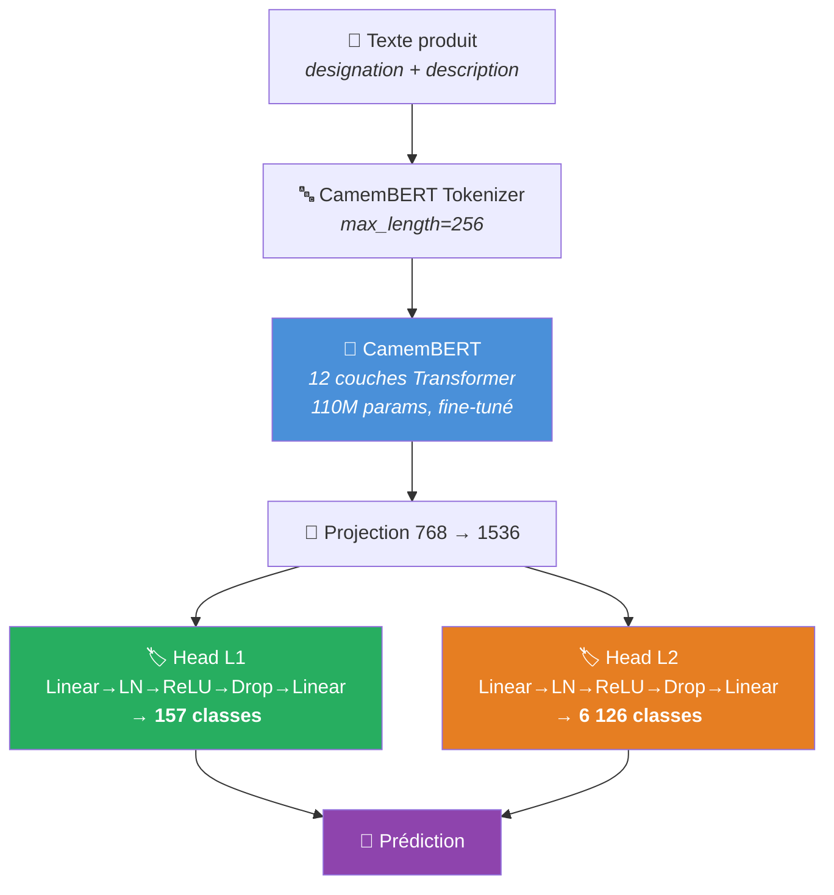
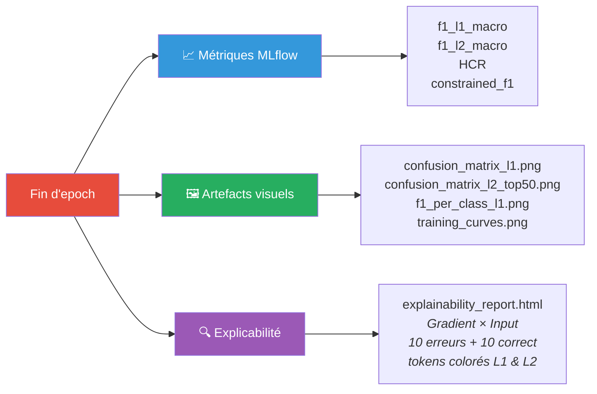

<div align="center">


# 🛒 Rakuten Hierarchical Product Classification

**8M+ produits · 157 catégories · 6 126 sous-catégories · CamemBERT**


> **Télécom Paris** (IP Paris) × **Rakuten France**

</div>

---

## 📌 Le projet en 30 secondes

Un produit arrive avec un titre et une description en français. Le modèle prédit **simultanément** sa catégorie (L1) et sa sous-catégorie (L2) :

```
"Coque iPhone 12 silicone transparente"
          │
          ▼
    ┌─ HYDRA ─┐
    │CamemBERT│
    │  12 × 🔄 │
    └────┬────┘
    ┌────┴────┐
    ▼         ▼
 L1: 157   L2: 6 126
Électronique  Coque téléphone
```

Deux approches comparées :
- **HYDRA** (EMNLP 2025) — Multi-tête encoder-only ✅
- **HLPD** (ECIR 2025) — Décodeur non-autorégressif avec attention hiérarchique 📋 *(à venir)*

---

## 🏗️ Architecture HYDRA



**3 variantes testées :**

| | Local | Global | Nested |
|---|---|---|---|
| **Idée** | Têtes indépendantes | + tête unifiée L1+L2 | + MLP de raffinement |
| **Loss** | `0.5·CE(L1) + CE(L2)` | + α · unified | + α · unified |
| **Cohérence L1↔L2** | Post-hoc (masque) | Implicite | Par construction |

---

## 📏 Baselines

| Modèle | F1 L1 | F1 L2 | HCR |
|--------|-------|-------|-----|
| TF-IDF + LinearSVC | 82.50% | 42.23% | 57.29% |
| FastText Supervised | 83.72% | 9.48% | 28.60% |
| Word2Vec + LinearSVC | 60.24% | 22.27% | 25.06% |

---

## ⚡ Fonctionnalités clés

<table>
<tr>
<td width="50%">

**🔬 Training**
- Fine-tuning complet (12 couches)
- DataParallel multi-GPU automatique
- DDP multi-nœud sur cluster SLURM
- Checkpoint tous les 10K steps
- Auto-resume après interruption SLURM
- Early stopping sur `val_f1_l2_macro`

</td>
<td width="50%">

**📊 Audit & MLflow**
- 30+ hyperparamètres loggés
- Confusion matrices L1/L2 à chaque epoch
- Per-class F1 (barplots triés)
- Training curves (loss + F1 + HCR)
- Explicabilité Gradient × Input (HTML)
- 77 tests pytest

</td>
</tr>
</table>

---

## 🚀 Quick Start

```bash
# Installation
git clone <repo-url> && cd rakuten-classification
python -m venv venv && source venv/bin/activate
pip install -r requirements.txt

# Dataset (splits pré-générés sur HuggingFace Hub)
export HF_TOKEN="hf_..."
python scripts/download_dataset.py

# Training
python scripts/run_train.py --split-dir /path/to/splits --variant local

# SLURM — job array par variante (10 tentatives, auto-resume)
sbatch --job-name=hydra-local --array=0-9%1 scripts/run_train_variant.slurm local

# SLURM — 3 variantes en parallèle
sbatch scripts/run_train_array.slurm

# SLURM — chaîner N arrays
./scripts/chain_submit_array.sh 3

# Tests
python -m pytest tests/ -v
```

---

## 📊 Dataset

> Propriétaire — non inclus dans le repo. Hébergé sur HuggingFace Hub (privé).

| Split | Échantillons | % | Champs |
|-------|-------------|---|--------|
| Train | 5 573 659 | 70% | `designation`, `description`, `typelabel` (L1), `producttype` (L2) |
| Val | 1 194 355 | 15% | Split stratifié par L2, seed=42 |
| Test | 1 194 356 | 15% | |

---

## 🎯 Métriques & Audit



**Objectif** : maximiser `f1_l2_macro` avec HCR > 95%

---

## 🔍 Explicabilité (Gradient × Input)

Le rapport HTML montre quels mots ont contribué à chaque prédiction :

```
L1 — Vrai: Électronique | Prédit: Électronique (98%) ✔
  Coque  iPhone  12  silicone  transparente
   ░░    ██████  ░    ██        █
         ↑ drive la prédiction L1

L2 — Vrai: Coque téléphone | Prédit: Coque téléphone (91%) ✔
  Coque  iPhone  12  silicone  transparente
  █████  ████    ░    █████     █████████
  ↑ drive la prédiction L2         ↑ aussi
```

---

## ⚙️ Configuration

Source de vérité : [`02_hydra/configs/default.yaml`](02_hydra/configs/default.yaml)

| Paramètre | Valeur | | Paramètre | Valeur |
|-----------|--------|-|-----------|--------|
| Encodeur | `camembert-base` | | `batch_size` | 64 |
| `max_length` | 256 | | `lr` | 3.5e-5 |
| Warmup | 10% (linéaire) | | Weight decay | 0.01 |
| Gradient clip | 1.0 | | Early stop | patience 2 |
| `dropout` | 0.3 | | `hidden_dim` | 256 |

Variante hiérarchique : [`02_hydra/configs/hierarchy.yaml`](02_hydra/configs/hierarchy.yaml) — active `condition_l2_on_l1` (teacher forcing) et `check_hierarchy` (masque à l'inférence)

---

## 📁 Structure

```
rakuten-classification/
├── 00_eda/                    Analyse exploratoire (EDA)
├── 01_baselines/              FastText, TF-IDF+LinearSVC, Word2Vec+LinearSVC
├── 02_hydra/
│   ├── configs/               default.yaml, hierarchy.yaml
│   └── src/                   models, losses, trainer, predict
├── 02b_hlpd/                  HLPD (à venir — Mehdi Aithamma)
├── 03_production/             DDP multi-nœud, SLURM
├── shared/                    data_loader, metrics, utils
├── scripts/                   train, SLURM arrays, évaluation, comparaison
├── results/                   Rapports HTML, métriques par modèle
├── tests/                     77 tests pytest
└── docker-compose.yml         MLflow, tests, training
```

---

## 📚 Références

- **HYDRA** — Karl et al., *Hierarchical Multi-label Classification*, EMNLP 2025 [[GitHub]](https://github.com/FKarl/HYDRA)
- **HLPD** — Torba, Laclau et al., *Hierarchical Label Pre-populated Decoder*, ECIR 2025

---

<div align="center">

**[Tahiana H. Andriambahoaka](https://github.com/tahianahajanirina) · [Mehdi Aithamma](https://github.com/MehdiiAH) · [Younes Boutrouft](https://github.com/inptensib) · Amir H. Kashani Rahimi**

</div>
