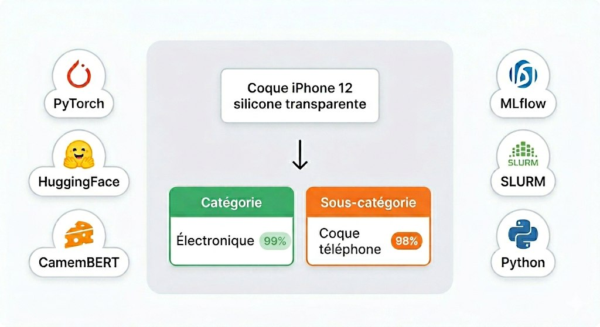
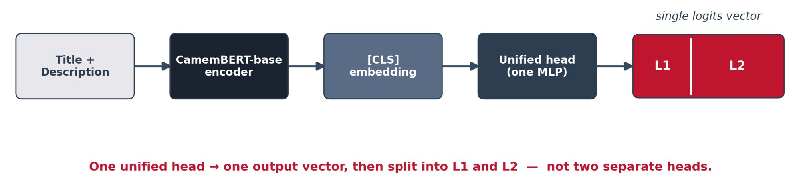
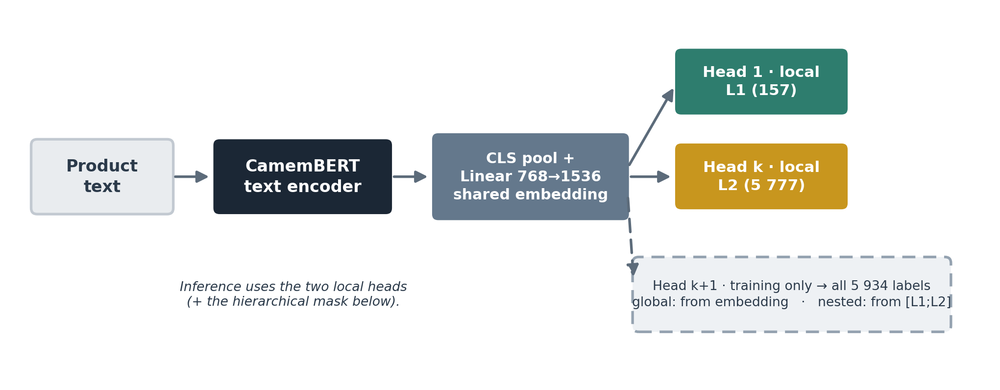
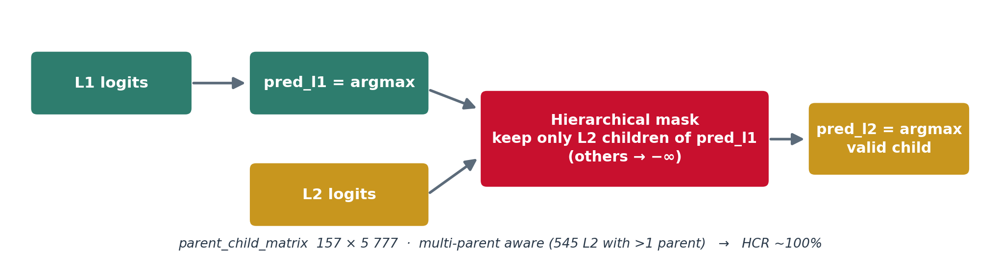
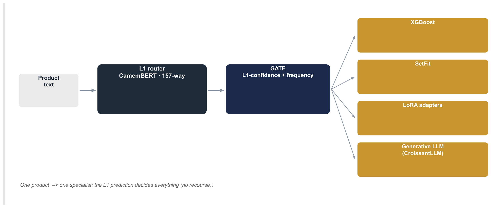
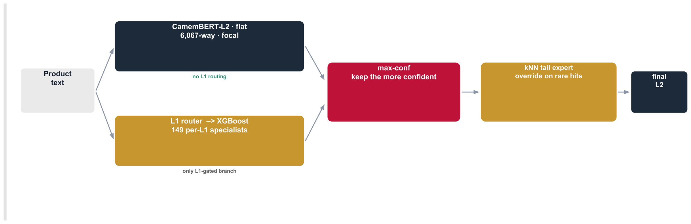
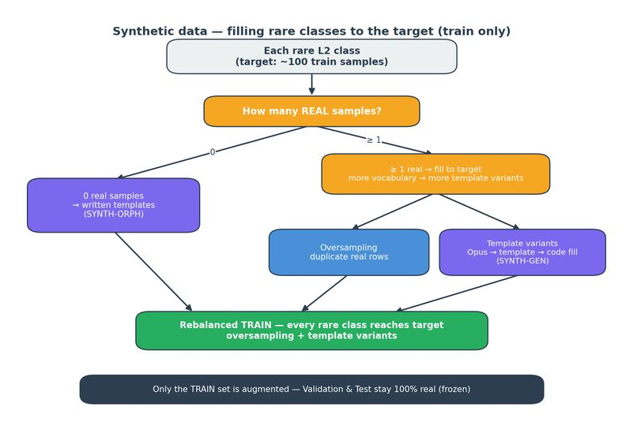
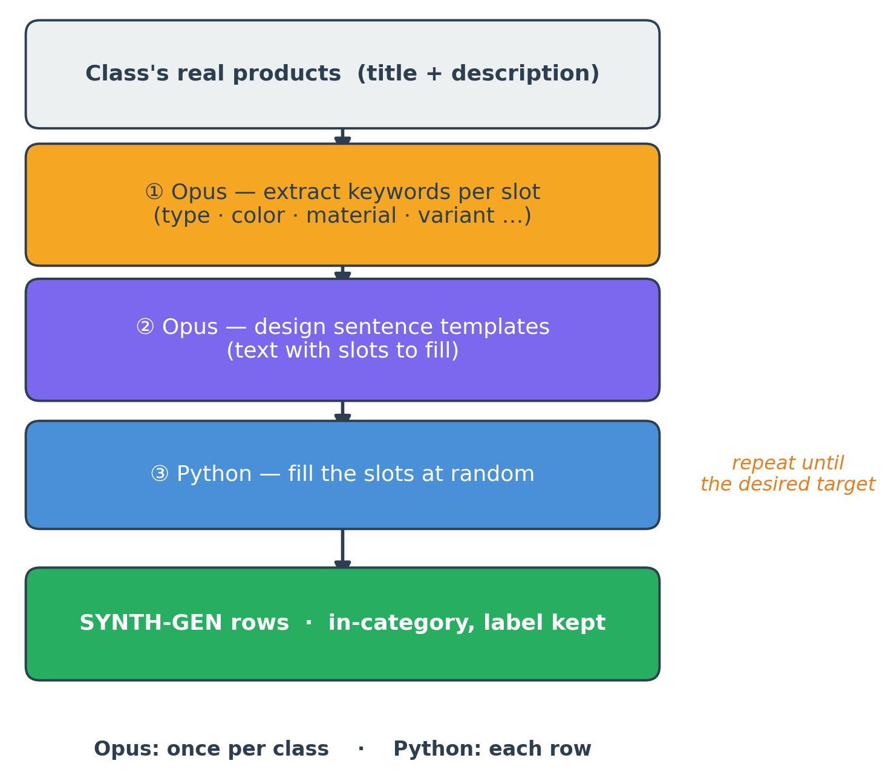

<div align="center">



# Rakuten Hierarchical Product Classification

**8M+ products · 157 categories · 5 777 subcategories · CamemBERT**


> **Télécom Paris** (IP Paris) × **Rakuten France**

</div>

---

## The project in 30 seconds

A product arrives with a title and a description in French. The model predicts
**simultaneously** its L1 category among 157 and its L2 subcategory among 5 777:

```
"iPhone 12 transparent silicone case"
          │
          ▼
    ┌─ HYDRA ─┐
    │CamemBERT│
    │ 12 layers │
    └────┬────┘
    ┌────┴────┐
    ▼         ▼
 L1: 157   L2: 5 777
Electronics  Phone case
```

Three model families compared:

| Family | Approach | Best F1 L2 (v1, test) |
|:--------|:---------|:-------------------:|
| Baselines | TF-IDF, Word2Vec, fastText + classifiers | 42.9 % |
| **FlatHydra** | CamemBERT + single L1+L2 head | **71.7 %** |
| HYDRA | CamemBERT multi-head (EMNLP 2025) | 66.8 % |
| HLPD | Hierarchical decoder (ECIR 2025) | 61.5 % |

> **v1 → v2 note (measured)**: these figures are on the **v1** dataset (train/test
> leakage not purged). On the de-leaked **v2** dataset, the re-evaluated FlatHydra
> CamemBERT yields **78.9 %** L2 F1 — not directly comparable to v1 (L2 classes
> go from 6 126 to 5 777). The leakage's own effect, measured at the L1 level
> (same 157 classes), is **~1 pt** (v1 slightly inflated).
> Details: [docs/METRICS.md](docs/METRICS.md).

---

## Architecture

Three architecture families were explored — all built on a fine-tuned
**CamemBERT** encoder: the retained **CamemBERT Flat** (single unified head), the
multi-head **HYDRA**, and a separate **hybrid** track (CamemBERT + per-L1
specialists).

### Retained model — CamemBERT Flat

A **single unified head** predicts L1 + L2 jointly. The projection is applied on
the token sequence **before** pooling (faithful to the official HYDRA baseline),
and the 5 934 output logits are sliced into L1 (`[0:157]`) and L2 (`[157:]`).



### HYDRA (multi-head) + hierarchical masking

Faithful to **HYDRA** (Karl & Scherp, EMNLP 2025): a shared **text encoder** feeds
**k local heads** (one per hierarchy level — here **k = 2**: L1 and L2). Two of the
three variants add an optional **(k+1)-th head** that predicts the flat union of
all labels (training only). A CLS pool + a 768→1536 projection build the shared
embedding the heads sit on.



**3 variants**, mapping directly to the paper's (a)/(b)/(c) — they differ only in
the optional **Head k+1** (training only); inference always uses the two local
heads + the mask below:

| Variant | Head k+1 (training only) | Paper |
|:---------|:-----|:----------------|
| `local` | none | (a) Local Heads Only |
| `global` | predicts all 5 934 labels from the embedding | (b) Local + Global Head |
| `nested` | predicts all 5 934 labels from the `[L1;L2]` logits | (c) Local + Nested Head |

At **inference** (all variants use the two local heads), a **hierarchical mask**
keeps only the L2 children of the predicted L1 — lifting the hierarchical
consistency rate (HCR) to ~100 %:



The mask uses a `parent_child_matrix` (157 × 5 777), **multi-parent aware**:
545 L2 classes have more than one valid L1 parent.

### Explored alternatives — hybrid systems

A separate experimental track ([`hybrid_system/`](hybrid_system/), unaudited)
combined CamemBERT with per-L1 specialists. Two designs were explored, both ruled
out in favour of the simpler CamemBERT Flat.

**Gated routing** — route each product to a single per-L1 specialist, gated by L1
confidence + class frequency. A wrong L1 route hands the product to the wrong
specialist, so L2 collapses: the L1 prediction decides everything, no recourse —
the L1 route is the bottleneck.



**Max-confidence** — two flat experts run in parallel (CamemBERT-L2 + per-L1
XGBoost on 1536-d embeddings), combined by keeping the more confident; a kNN tail
expert overrides on confident rare-class hits. A wrong L1 route only makes XGBoost
abstain, so the routing-free flat predictor still stands. Competitive, but heavier
for no gain over the plain CamemBERT Flat.



> **Key finding**: the flat *FlatHydra* head (CamemBERT + a single L1+L2 head)
> achieves the project's best L2 F1 — above the multi-level HYDRA heads **and the
> hybrid systems**. Despite its name, FlatHydra is **not** a HYDRA variant: it is a
> strong baseline (filed under `rakuten/models/baselines/`).

---

## Results

Retained model: **CamemBERT Flat v2 — 78.9 % L2 macro-F1**, the project's best
(above the multi-head HYDRA and the hybrid systems). Full per-model tables
(baselines, HYDRA, HLPD, FlatHydra; v1 + v2; traced to source files):
[docs/EXPERIMENTS.md](docs/EXPERIMENTS.md).

---

## Synthetic data pipeline

Rakuten's catalogue has a heavy **long tail**: many L2 classes hold very few
products, which caps the macro-F1. The pipeline
([`scripts/synthetic_pipeline/`](scripts/synthetic_pipeline/)) rebalances **train
only** so every L1 (157) and every L2 (5 777) class reaches **≥ 100 products** —
**val and test stay frozen** (every generated row is hash-checked against them, so
nothing leaks).

The **LLM (Claude Opus) is in the loop at generation time**: it reads each class
and decides its vocabulary (keywords) and its listing shapes (templates). Python then does the
mechanical work — filling templates, duplicating real rows for raw volume, and
validating.





Two strategies, composed to exactly 100 rows per class (generated first, then
duplication to top up):

| Kind | Rows | How |
|:------|-----:|:----|
| `SYNTH-OVS` | 119 510 | duplication (L2) |
| `SYNTH-GEN` | 7 044 | LLM templates, anchored in the class's real vocabulary |
| `SYNTH-ORPH` | 2 900 | LLM templates, 29 orphan classes (no real rows) × 100 |
| `SYNTH-OVL` | 187 | duplication (L1) |
| **Total** | **129 641** | added on top of the real training data |

Synthetic rows are identifiable by the non-numeric `SYNTH-` prefix on `productid`.
The whole chain runs **without an LLM** for testing (`RAKUTEN_LLM_OFFLINE=1`); see
[`scripts/synthetic_pipeline/README.md`](scripts/synthetic_pipeline/README.md) and
[`WORKED_EXAMPLE.md`](scripts/synthetic_pipeline/WORKED_EXAMPLE.md).

---

## Quick Start

> **New here?** [ONBOARDING.md](ONBOARDING.md) covers install, data/model access,
> first run and SLURM; [docs/PIPELINE.md](docs/PIPELINE.md) is the script × model
> matrix. **To re-train or re-test the delivered models → [REPRODUCE.md](REPRODUCE.md).**

```bash
# Install (CPU or another CUDA: install torch first — see requirements.txt)
git clone <repo-url> && cd rakuten-classification
python -m venv venv && source venv/bin/activate && pip install -e .

# Verify — no data or GPU needed
python -m pytest tests/ -q                     # 312 tests pass

# Download data + local smoke test (HF token required — see below)
export HF_TOKEN="hf_..."
python scripts/download_dataset.py
python scripts/run_train.py --split-dir dataset/ --n-samples 5000 --config configs/hydra/default.yaml

# Full training on SLURM
sbatch --job-name=hydra-local --array=0-9%1 scripts/slurm/run_train_variant.slurm local
```

---

## Access to data and models

Three **private** HuggingFace repos (owner `TahianaAndriambahoaka` — ask for a read
token). Without a token you can still `pip install -e .` and run the 312 tests
(no data, no GPU) — the normal fallback path.

| Repo | Download with | Content |
|:--|:--|:--|
| [`rakuten-dataset`][hf-dataset] | `scripts/download_dataset.py` | v2 splits (`datasets_finaux/`, 70/15/15 stratified by L2) — train 5 259 035 / val 1 194 355 / test 1 194 356 |
| [`rakuten-models`][hf-models] | `scripts/download_models.py [name]` | 22 trained models (~63 GB) |
| [`rakuten-delivery`][hf-delivery] | `scripts/download_delivery.py` | **one-shot handoff** — the 4 ONNX models + v2 dataset (~9 GB) |

```bash
export HF_TOKEN="hf_..."             # read token provided by the owner
python scripts/download_dataset.py   # → dataset/
python scripts/download_models.py    # → models/  (or one model: ... flat-hydra-camembert-v2)
```

### Delivery bundle — offline ONNX inference

`rakuten-delivery` bundles everything needed to **run** the models (no training):
`onnx/flat_v2/` (retained model), `onnx/hydra_v2/` (3 HYDRA + mask matrix) and
`dataset_v2/`, each with a standalone `predict_onnx.py`. **Inference is fully
offline** — `onnxruntime` only, no PyTorch, no Hugging Face at runtime:

```bash
python scripts/download_delivery.py --onnx-only        # ~1.8 GB
cd rakuten-delivery/onnx/flat_v2 && pip install -r requirements.txt
python predict_onnx.py --model-dir . --designation "Cage à hamster 3 étages" --description "Métal, 60x40 cm"
```

The same export/inference code is in [`scripts/flat_inference/`](scripts/flat_inference/)
and [`scripts/hydra_inference/`](scripts/hydra_inference/). HF→local model mapping:
[ONBOARDING.md](ONBOARDING.md). SLURM jobs (`scripts/slurm/*.slurm`) override paths
via `PROJECT_ROOT` / `VENV_ACTIVATE` / `DATA_DIR`.

[hf-dataset]: https://huggingface.co/datasets/TahianaAndriambahoaka/rakuten-dataset
[hf-models]: https://huggingface.co/TahianaAndriambahoaka/rakuten-models
[hf-delivery]: https://huggingface.co/TahianaAndriambahoaka/rakuten-delivery

---

## Metrics

Defined in `rakuten/common/metrics.py` ([docs/METRICS.md](docs/METRICS.md)):
**`f1_l2_macro`** is the main target (macro over the 5 777 L2 classes), alongside
`f1_l1_macro`, **HCR** (share of predictions where L2 is a valid child of L1) and
`constrained_f1`. Goal: maximize `f1_l2_macro` with HCR > 95 %. Training also logs
confusion matrices, per-class F1 and an MLflow explainability report.

---

## HYDRA configuration

Source of truth [`configs/hydra/default.yaml`](configs/hydra/default.yaml):
`camembert-base` · `max_length` 256 · `batch_size` 64 · `lr` 3.5e-5 · `dropout` 0.3
· `hidden_dim` 256 · 10 % linear warmup · gradient clip 1.0 · early stop patience 2.
Hierarchical variant [`hierarchy.yaml`](configs/hydra/hierarchy.yaml) adds teacher
forcing (`condition_l2_on_l1`) + the inference mask (`check_hierarchy`).

---

## Structure

```
rakuten/         installable package — common/ + models/{baselines, hydra, hlpd}
configs/         YAML, source of truth — hydra/, baselines/, hlpd/
scripts/         CLI entry points (root) + slurm/ · flat_inference/ · hydra_inference/ · synthetic_pipeline/
notebooks/       eda/ + baselines/
docs/            ARCHITECTURE · PIPELINE · METRICS · EXPERIMENTS
results/         per-model metrics + HTML reports     ·     tests/  312 pytest (no data/GPU)
hybrid_system/   separate experimental track (CamemBERT + XGBoost, unaudited)
```

Detailed tree + old → new mapping: [docs/ARCHITECTURE.md](docs/ARCHITECTURE.md).

---

## Contributing

See [CONTRIBUTING.md](CONTRIBUTING.md) — branching, quality pipeline (tests + lint), commit format.

---

## References

- **HYDRA** — Karl & Scherp, *Hierarchical Multi-label Classification*, EMNLP 2025 [[GitHub]](https://github.com/FKarl/HYDRA)
- **HLPD** — Torba, Laclau et al., *Hierarchical Label Pre-populated Decoder*, ECIR 2025

---

<div align="center">

**[Tahiana H. Andriambahoaka](https://github.com/tahianahajanirina) · [Mehdi Aithamma](https://github.com/MehdiiAH) · [Younes Boutrouft](https://github.com/inptensib) · Amir H. Kashani Rahimi**

</div>
