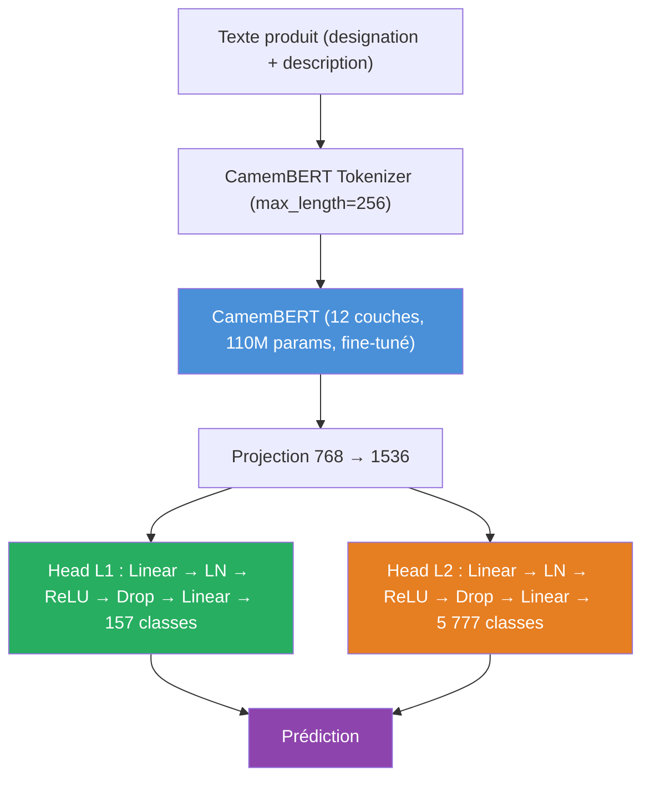

<div align="center">


# Rakuten Hierarchical Product Classification

**8M+ produits · 157 catégories · 5 777 sous-catégories · CamemBERT**


> **Télécom Paris** (IP Paris) × **Rakuten France**

</div>

---

## Le projet en 30 secondes

Un produit arrive avec un titre et une description en français. Le modèle prédit
**simultanément** sa catégorie L1 parmi 157 et sa sous-catégorie L2 parmi 5 777 :

```
"Coque iPhone 12 silicone transparente"
          │
          ▼
    ┌─ HYDRA ─┐
    │CamemBERT│
    │  12 couches │
    └────┬────┘
    ┌────┴────┐
    ▼         ▼
 L1: 157   L2: 5 777
Électronique  Coque téléphone
```

Trois familles de modèles comparées :

| Famille | Approche | Meilleur F1 L2 (v2) |
|:--------|:---------|:-------------------:|
| Baselines | TF-IDF, Word2Vec, fastText + classifieurs | 42.9 % |
| **FlatHydra** | CamemBERT + tête unique L1+L2 | **71.7 %** |
| HYDRA | CamemBERT multi-têtes (EMNLP 2025) | 66.8 % |
| HLPD | Décodeur hiérarchique (ECIR 2025) | 61.5 % |

> **Avertissement fuite v1 → v2** : les benchmarks produits avant le 12/06/2026
> sont gonflés de +1,5 à +3 pts (doublons train/test purgés). Les chiffres
> ci-dessus sont les valeurs v2. Détail : [docs/METRICS.md](docs/METRICS.md).

---

## Architecture HYDRA



3 variantes testées :

| Variante | Idée | Cohérence L1↔L2 |
|:---------|:-----|:----------------|
| `local` | Têtes L1 et L2 indépendantes | Post-hoc (masque hiérarchique) |
| `global` | + tête unifiée L1+L2 | Implicite |
| `nested` | + MLP de raffinement L2 conditionné sur L1 | Par construction |

---

## Résultats clés

| Modèle | F1 L1 | F1 L2 | HCR |
|:-------|:-----:|:-----:|:---:|
| TF-IDF + LinearSVC | 82.50 % | 42.23 % | 57.29 % |
| FastText Supervised | 83.72 % | 9.48 % | 28.60 % |
| Word2Vec + LinearSVC | 60.24 % | 22.27 % | 25.06 % |
| **FlatHydra CamemBERT** | **—** | **71.7 %** | — |
| HYDRA local CamemBERT | — | 66.8 % | > 95 % |
| HLPD CamemBERT | — | 61.5 % | — |

---

## Quick Start

> **Nouveau sur le projet ?** Suivre [ONBOARDING.md](ONBOARDING.md) — installation,
> accès aux données et modèles, premier entraînement, SLURM.
> Référence détaillée : [docs/PIPELINE.md](docs/PIPELINE.md) (quel script pour quel modèle)
> et [docs/METRICS.md](docs/METRICS.md) (métriques et provenance des résultats).

```bash
# 1. Cloner et installer
git clone <repo-url> && cd rakuten-classification
python -m venv venv && source venv/bin/activate
pip install -e .

# 2. Vérifier l'installation — aucune donnée ni GPU requis
python -m pytest tests/ -q          # 301 tests doivent passer

# 3. Télécharger les données (token HF requis — voir section suivante)
export HF_TOKEN="hf_..."
python scripts/download_dataset.py

# 4. Smoke test local (CPU, ~10 min)
python scripts/run_train.py --split-dir dataset/ --n-samples 5000 \
    --config configs/hydra/default.yaml

# 5. Entraînement complet sur cluster SLURM
sbatch --job-name=hydra-local --array=0-9%1 scripts/run_train_variant.slurm local
```

---

## Accès aux données et modèles

> **Repos HuggingFace privés** — un token HF en lecture est requis.
> Contacter : `TahianaAndriambahoaka` (propriétaire des repos).

### Sans accès (voie de repli)

Il est possible d'installer le package et de lancer les 301 tests **sans données ni GPU** :

```bash
pip install -e .
python -m pytest tests/ -q   # 301 passed
```

Ce que cela couvre : imports, architecture des modèles, métriques, configs, utilitaires.
Ce que cela ne couvre pas : entraînements et évaluations réelles.

### Données (dataset v2)

Repo HF privé : [`TahianaAndriambahoaka/rakuten-dataset`][hf-dataset]
Sous-dossier : `datasets_finaux/` — splits pré-générés (70/15/15, stratifiés par L2, seed=42).

| Fichier | Lignes |
|:--------|-------:|
| `train_split.jsonl` | 5 259 035 |
| `val_split.jsonl` | 1 124 793 |
| `test_split.jsonl` | 1 124 793 |

Chaque ligne : `{"designation": "...", "description": "...", "typelabel": "L1", "producttype": "L2"}`

```bash
export HF_TOKEN="hf_..."           # token read fourni par le propriétaire
python scripts/download_dataset.py  # télécharge dans <repo>/dataset/
```

> **Dataset v2** : fuite de doublons purgée (−448 359 lignes de train).
> Les benchmarks antérieurs (v1) sont gonflés de +1,5 à +3 pts.
> Voir [docs/METRICS.md](docs/METRICS.md).

### Modèles entraînés (~50 Go)

Repo HF privé : [`TahianaAndriambahoaka/rakuten-models`][hf-models]
Télécharger uniquement le sous-dossier nécessaire :

```python
from huggingface_hub import snapshot_download
snapshot_download(
    repo_id="TahianaAndriambahoaka/rakuten-models",
    allow_patterns="flat-hydra/*",   # remplacer selon le modèle voulu
    token="hf_...",
)
```

Correspondance sous-dossiers HF → chemins locaux attendus par les scripts d'évaluation :
voir [ONBOARDING.md](ONBOARDING.md) section « Récupérer les modèles entraînés ».

### Cluster SLURM

Les scripts `scripts/*.slurm` supposent les partitions `P100` (2×16 Go)
et `3090` (2-4×24 Go) du cluster Télécom Paris.
Sur une autre infrastructure, adapter les directives `#SBATCH` et les variables :

```bash
export PROJECT_ROOT="/chemin/vers/rakuten-classification"
export VENV_ACTIVATE="/chemin/vers/venv/bin/activate"
export DATA_DIR="/chemin/vers/dataset"
```

[hf-dataset]: https://huggingface.co/datasets/TahianaAndriambahoaka/rakuten-dataset
[hf-models]: https://huggingface.co/TahianaAndriambahoaka/rakuten-models

---

## Métriques

Toutes définies dans `rakuten/common/metrics.py`, documentées dans [docs/METRICS.md](docs/METRICS.md).

| Métrique | Description |
|:---------|:------------|
| `f1_l1_macro` | F1 macro sur les 157 catégories L1 |
| `f1_l2_macro` | F1 macro sur les 5 777 sous-catégories L2 — **métrique principale** |
| `HCR` | Taux de cohérence hiérarchique : % de prédictions où L2 est enfant valide de L1 |
| `constrained_f1` | F1 L2 compté seulement si L1 parent correct |

Objectif : maximiser `f1_l2_macro` avec HCR > 95 %.

Chaque epoch logue également : matrices de confusion L1/L2, F1 par classe (barplots triés),
et un rapport d'explicabilité HTML (Gradient × Input) disponible dans MLflow
(`docker compose up mlflow -d`).

---

## Configuration HYDRA

Source de vérité : [`configs/hydra/default.yaml`](configs/hydra/default.yaml)

| Paramètre | Valeur | | Paramètre | Valeur |
|-----------|--------|-|-----------|--------|
| Encodeur | `camembert-base` | | `batch_size` | 64 |
| `max_length` | 256 | | `lr` | 3.5e-5 |
| Warmup | 10% (linéaire) | | Weight decay | 0.01 |
| Gradient clip | 1.0 | | Early stop | patience 2 |
| `dropout` | 0.3 | | `hidden_dim` | 256 |

Variante hiérarchique : [`configs/hydra/hierarchy.yaml`](configs/hydra/hierarchy.yaml) — active `condition_l2_on_l1` (teacher forcing) et `check_hierarchy` (masque à l'inférence)

---

## Structure

```
rakuten-classification/
├── rakuten/                   Package Python installable (pip install -e .)
│   ├── common/                data_loader, metrics, training_utils, utils
│   └── models/
│       ├── baselines/         TF-IDF, Word2Vec, fastText, FlatHydra
│       ├── hydra/             HYDRA (EMNLP 2025) : models, losses, trainer, config
│       └── hlpd/              HLPD (ECIR 2025) — Mehdi Aithamma
├── configs/                   YAML hors package (source de vérité)
│   ├── hydra/                 default.yaml, hierarchy.yaml, title_only*.yaml
│   ├── baselines/             flat_hydra*.yaml
│   └── hlpd/                  hlpd_3090.yaml
├── scripts/                   CLI Python, scripts SLURM, évaluation, comparaison
├── notebooks/
│   ├── eda/                   Analyse exploratoire
│   └── baselines/             fastText, TF-IDF, Word2Vec (notebooks)
├── docs/                      ARCHITECTURE.md, PIPELINE.md, METRICS.md
├── results/                   Rapports HTML, métriques par modèle
├── tests/                     301 tests pytest (sans données ni GPU)
├── hybrid_system/             Contribution séparée — hors package (voir README dédié)
├── ONBOARDING.md              Guide de prise en main complet
└── docker-compose.yml         MLflow, tests, training
```

Architecture détaillée et table de correspondance ancien → nouveau :
[docs/ARCHITECTURE.md](docs/ARCHITECTURE.md)

---

## Références

- **HYDRA** — Karl et al., *Hierarchical Multi-label Classification*, EMNLP 2025 [[GitHub]](https://github.com/FKarl/HYDRA)
- **HLPD** — Torba, Laclau et al., *Hierarchical Label Pre-populated Decoder*, ECIR 2025

---

<div align="center">

**[Tahiana H. Andriambahoaka](https://github.com/tahianahajanirina) · [Mehdi Aithamma](https://github.com/MehdiiAH) · [Younes Boutrouft](https://github.com/inptensib) · Amir H. Kashani Rahimi**

</div>
