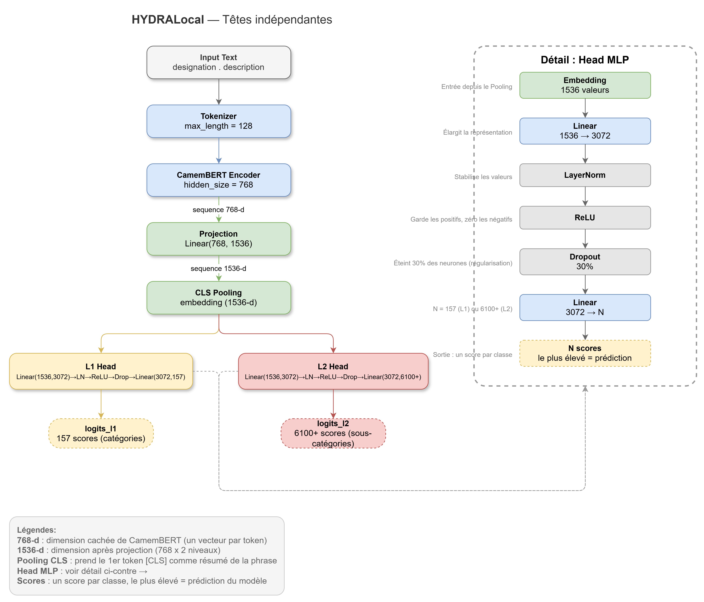

# 02_hydra -- HYDRA : Classification Hiérarchique Multi-tête

Implémentation de **HYDRA** (Karl et al., EMNLP 2025) pour la classification hiérarchique de produits Rakuten.

## Architecture



### 3 variantes

| Variante | Mécanisme |
|----------|-----------|
| **HYDRALocal** | Têtes L1/L2 indépendantes |
| **HYDRAGlobal** | + tête globale produisant des logits joints pour les (L1 + L2) classes |
| **HYDRANested** | + tête de raffinement (MLP sur logits L1+L2 concaténés) pour cohérence hiérarchique |

## Pertes

- **FocalLoss** : `FL(p_t) = -(1 - p_t)^gamma * log(p_t)` -- concentre l'apprentissage sur les cas difficiles (gamma=0 revient à la CE standard)
- **HYDRALoss** : `L = w_L1 * L1 + w_L2 * L2 [+ w_global * L_global]` -- combine CrossEntropy ou FocalLoss par niveau

## Configuration (`configs/default.yaml`)

| Paramètre | Default | Description |
|-----------|---------|-------------|
| `encoder` | `camembert-base` | Backbone |
| `variant` | `local` | `local` / `global` / `nested` |
| `dropout` | `0.3` | Dropout avant heads |
| `lr` | `3.5e-5` | Learning rate |
| `batch_size` | `64` | Taille de batch |
| `epochs` | `10` | Nombre d'époques |
| `loss` | `cross_entropy` | `cross_entropy` / `focal` |
| `level_weights` | `[0.5]` | Poids L1 (L2 implicitement 1.0) |

> La dimension de projection est calculée automatiquement : `d_model * num_levels` (768 * 2 = 1536 pour CamemBERT).

### Configurations spécialisées

| Config                      | Description |
|-----------------------------|-------------|
| `hierarchy.yaml`            | Conditioning hiérarchique L2\|L1 : teacher forcing au training, masque à l'inférence, `save_dir: models_hierarchy` |
| `mbert_default.yaml`        | Encodeur mBERT (`bert-base-multilingual-cased`), identique à `default.yaml` sinon |
| `title_only.yaml`           | Designation seule (sans description), `max_length: 128`, `save_dir: models_title` |
| `title_only_hierarchy.yaml` | Title-only + conditioning hiérarchique, `save_dir: models_title_hierarchy` |

## Usage

*Note : exemple d'API bas-niveau. Pour entraîner, passer par HYDRATrainer via scripts/run_train.py (voir docs/PIPELINE.md).*

```python
from rakuten.models.hydra.models import create_hydra_model
from rakuten.models.hydra.losses import HYDRALoss

model = create_hydra_model(
    variant="local", encoder_name="camembert-base",
    num_classes_l1=157, num_classes_l2=6126,
)

criterion = HYDRALoss(
    architecture="local", num_classes_l1=157, num_classes_l2=6126,
    use_focal=True, level_weight_l1=0.5,
)

level_outputs, unified_output = model(input_ids, attention_mask)
logits_l1, logits_l2 = level_outputs
loss, loss_l1, loss_l2 = criterion(level_outputs, unified_output, labels_l1, labels_l2)
```

## Structure

```
02_hydra/
  configs/default.yaml    # Hyperparamètres
  src/
    models.py             # HYDRABase, HYDRALocal, HYDRAGlobal, HYDRANested
    losses.py             # FocalLoss, HYDRALoss
    trainer.py            # Boucle d'entraînement single-GPU
    predict.py            # Inférence et évaluation
    config.py             # Mapping YAML → kwargs HYDRATrainer (source unique)
```

## Références

- Karl et al., *HYDRA*, EMNLP 2025.
- Lin et al., *Focal Loss for Dense Object Detection*, ICCV 2017.
